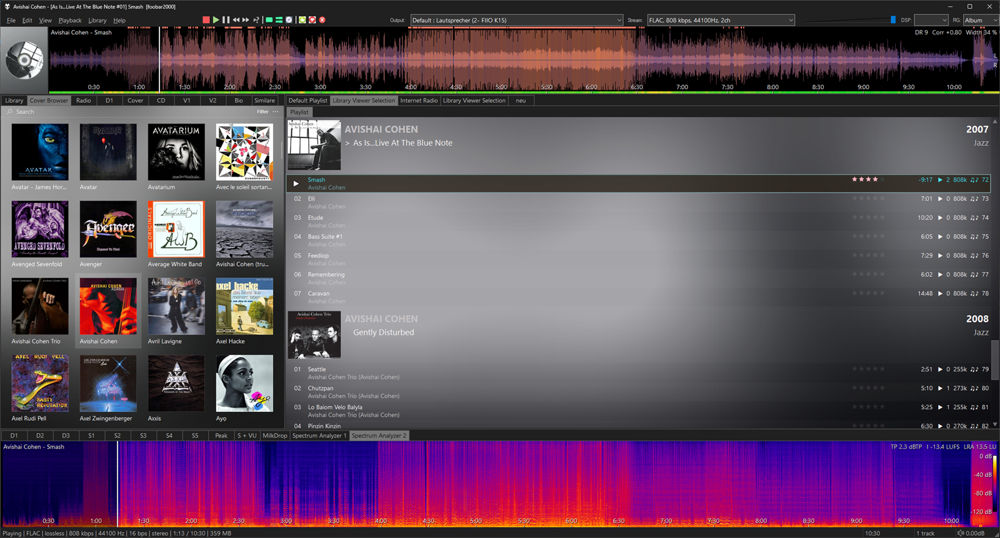
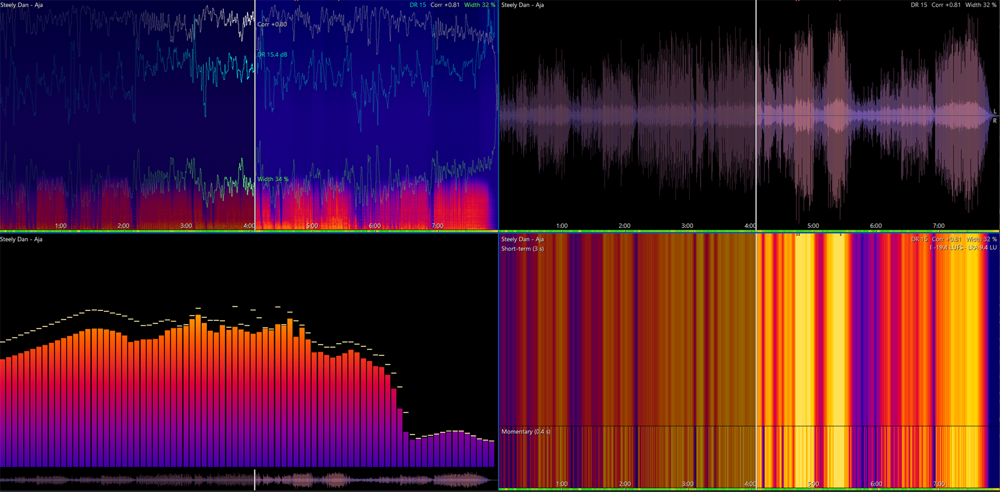
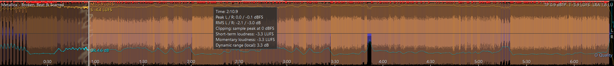
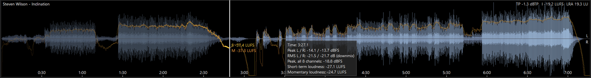
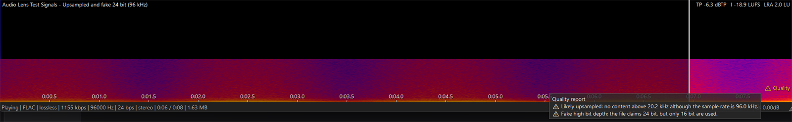
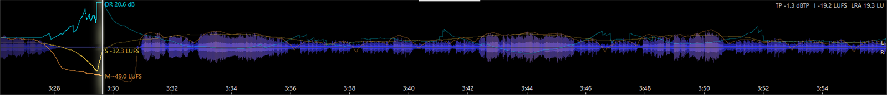
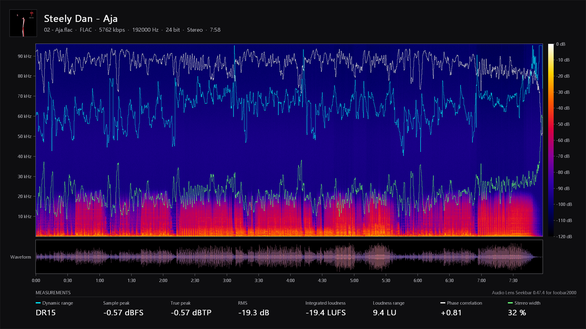
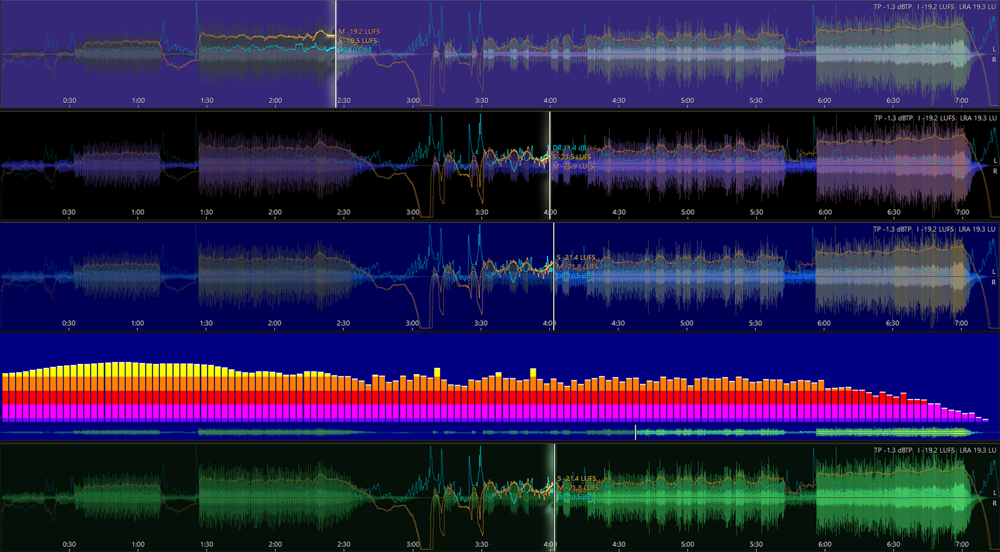
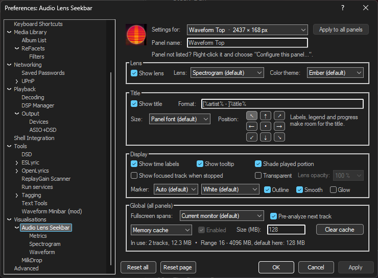
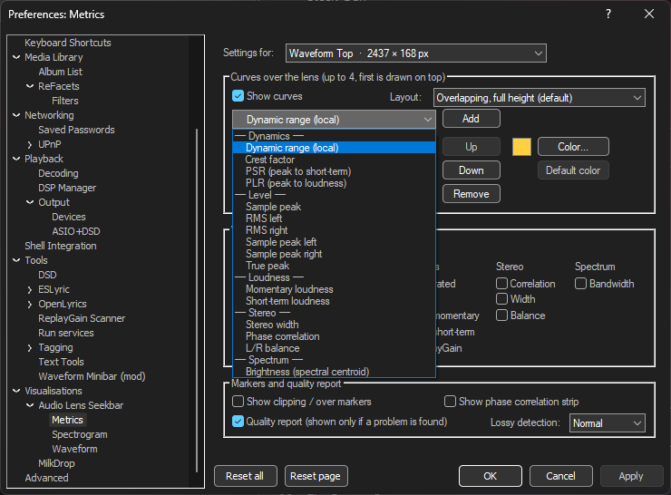

# Audio Lens Seekbar

A seekbar component for [foobar2000](https://www.foobar2000.org) that shows the whole track as a picture you
can click — a spectrogram, waveform, live spectrum or loudness map — with standards-compliant measurements on
top.

Default UI and Columns UI · 64 and 32 bit · no external tools (no ffmpeg), no scripting · free

**[Download the latest version](../../releases/latest)** · [Changelog](CHANGELOG.md)

*Waveform lens as the main seekbar, spectrogram lens with level scale below — two independent panels.*

## Requirements

- foobar2000 2.0 or newer, 64-bit or 32-bit
- Windows 10 or 11

## Installation

1. Download `foo_audiolens-<version>.fb2k-component` from the [releases](../../releases/latest).
2. Double-click it, or use *Preferences → Components → Install…*, and restart foobar2000.
3. Add the panel:
   - **Default UI:** *View → Layout → Enable layout editing*, right-click an area, *Add New UI Element →
     Visualisation → Audio Lens Seekbar*.
   - **Columns UI:** *Preferences → Columns UI → Layout*, add *Audio Lens Seekbar* (category
     *Visualisations*); it can also be used as a toolbar.

## Lenses

*The same track in all four lenses: spectrogram with metric curves, waveform, live spectrum bars at the playback
position, loudness heatmap.*

| Lens | Shows |
|---|---|
| Spectrogram | Frequency content over time, linear or logarithmic, mix / left / right / side / stereo, FFT 1024–16384 |
| Waveform | Peak and RMS envelope, plain or three frequency bands, stereo or mono |
| Spectrum bars | Live bar spectrum at the playback position, with a waveform timeline |
| Loudness heatmap | Short-term and momentary loudness (EBU R128) |

## Measurements

*Clipping markers along the top, true peak above 0 dBTP, a local dynamic range around 4 dB.*

- **Curves** (up to four): local dynamic range, crest factor, PSR, PLR, sample peak (total, left, right), true
  peak, RMS left/right, momentary and short-term loudness, stereo width, phase correlation, L/R balance,
  brightness (spectral centroid).
- **Values** in the corner: DR (TT DR Offline Meter algorithm, track and per channel), integrated loudness,
  loudness range, max. momentary / short-term loudness, sample and true peak, RMS, PLR, crest factor,
  ReplayGain, correlation, width, balance, bandwidth.
- Clipping and true-peak markers, phase correlation strip.

### Accuracy

Loudness, loudness range and true peak are checked against the EBU Loudness Test Set (EBU Tech 3341 and 3342)
and the compliance material of ITU-R BS.2217 (mono up to 22.2 channels): all 122 checks pass within the
tolerances of the standards, typically within 0.03 LU. The track DR matches foo_dr_meter.

### Multichannel

*A Dolby Atmos (TrueHD) track: loudness and true peak over all 8 channels, the waveform shows a stereo
downmix.*

Loudness follows ITU-R BS.1770 over all channels (surround channels weighted, LFE excluded); 5.1, 7.1, Dolby
Atmos channel beds and more. The display shows a stereo downmix.

## Quality report (optional)

*A 96 kHz / 24 bit file that is neither: nothing above 20 kHz and only 16 bits in use.*

Detects upsampled or resampled files, a possible lossy source (adjustable sensitivity), fake bit depth,
clipping, DC offset, inter-sample peaks and mono compatibility problems. Off by default; when enabled, a small
badge appears only if something is found.

## Zoom, export and more

*Ctrl + wheel zooms into the timeline; the visible section is analyzed again in finer detail.*

*An exported analysis sheet with cover, spectrogram, curves, waveform and measurements.*

- Every panel has its own settings and name; 9 built-in presets plus your own.
- 19 color themes, including C64, Amstrad CPC, NES, Sega Master System, Amiga and an adaptive theme from the
  album art.
- Position marker to your taste: width down to a crisp 1 px line, color, outline, optional glow.
- Transparent background: the panel can show your layout's or skin's background, with adjustable lens opacity.
- Fullscreen across one or more monitors.
- Export the view or an analysis sheet as PNG or to the clipboard.
- Playlist context menu *Audio Lens → Analyze (add to cache) / Remove from cache*; optionally analyzes the next
  track during playback. Results are kept in a memory and a compressed disk cache; panels showing the same
  track share one analysis.

*Some of the themes: C64, NES, Sega Master System, Amstrad CPC (spectrum bars), green monitor.*

## Usage

| Action | Effect |
|---|---|
| Click / drag | Seek (when stopped: start playback there) |
| Mouse wheel | Seek −/+ 5 s |
| Ctrl + wheel | Zoom at the mouse position |
| Shift + wheel, horizontal wheel, Ctrl + drag | Pan |
| Home | Reset zoom |
| Middle click | Fullscreen on/off (Esc or F11 to leave) |
| Right click | Menu: lens, metrics, color theme, display, zoom, presets, configure, export, fullscreen |

Panel settings: right-click → *Configure this panel…*. Defaults for new panels, all visible panels and global
options (cache, fullscreen, pre-analysis): *Preferences → Visualisations → Audio Lens Seekbar*.

*Main page: settings for a chosen panel or the defaults for new panels — lens, title, display, position marker,
transparency, cache.*

*Metrics page: curves, values and the quality report.*

## Feedback

Bug reports and suggestions are welcome — in the [issues](../../issues) or in the hydrogenaudio forum thread.

## License

Copyright (c) 2026 Audio Lens. All rights reserved. The component is free of charge; the unmodified package may
be passed on. See [LICENSE.txt](LICENSE.txt). This repository contains documentation and releases only; the
source code is not published.

Third-party software used by the component — the foobar2000 SDK, pfc and libPPUI, the Columns UI SDK, WTL and
PFFFT — is listed with its licenses in [THIRD-PARTY-NOTICES.txt](THIRD-PARTY-NOTICES.txt).
